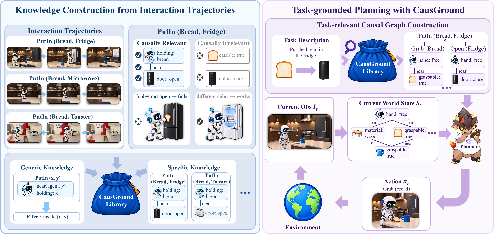
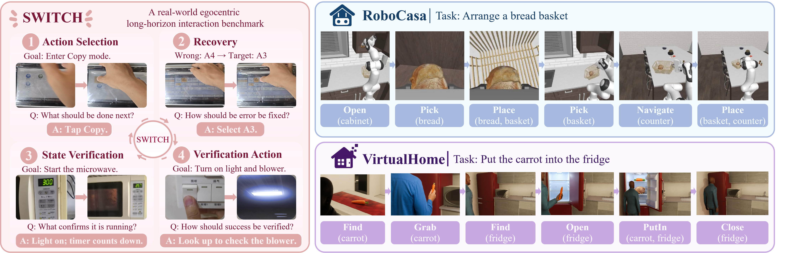

<div align="center">

# CausGround: Causal Interaction Grounding for Adaptive Embodied Planning

<p>
  Yijun Shen<sup>1,2</sup> &nbsp;&nbsp;
  Diqi He<sup>2,3</sup> &nbsp;&nbsp;
  Jinbang Guo<sup>2</sup> &nbsp;&nbsp;
  Wanyue Zhang<sup>2,4,5</sup> &nbsp;&nbsp;
  Jiaming Mi<sup>1</sup><br>
  Huan Yang<sup>2</sup> &nbsp;&nbsp;
  Zhongyuan Wang<sup>2</sup> &nbsp;&nbsp;
  Zhiwei Yu<sup>2,*</sup> &nbsp;&nbsp;
  Kai Zhang<sup>1,*</sup>
</p>

<p>
   <sup>1</sup> East China Normal University &nbsp;&nbsp;&nbsp;
   <sup>2</sup> Beijing Academy of Artificial Intelligence (BAAI)
</p>
<p>
   <sup>3</sup> Northwestern Polytechnical University
</p>
<p>
   <sup>4</sup> School of Artificial Intelligence, University of Chinese Academy of Sciences
</p>
<p>
   <sup>5</sup> Institute of Automation, Chinese Academy of Sciences
</p>

<p>
  <sup>*</sup> Corresponding authors
</p>

[**🔗 Project Website**](https://causground.github.io/) | [**📄 Read the Paper**](https://arxiv.org/abs/2610.29702) | [**🤗 Download Dataset**](https://huggingface.co/datasets/YijunShen/CausGround)

</div>

---

## 📖 Introduction

Multimodal large language models (MLLMs) have demonstrated promising capabilities in embodied planning. However, successful physical interaction requires not only knowing **what actions to perform**, but also **when an action is executable and how it changes the environment**. Such action preconditions and effects are often environment-dependent and cannot be reliably inferred from pretrained knowledge alone. Existing adaptation approaches either require costly environment-specific training or rely on unstructured interaction experience that is difficult to ground and reuse across tasks.

To address this challenge, we introduce **CausGround**, a non-parametric causal interaction grounding framework for adaptive embodied planning. CausGround distills interaction experience into reusable action-centered causal knowledge by identifying **action preconditions and state effects**, organized through a factorized world-state representation that captures both object attributes and inter-object relations. Given a task and current observation, CausGround grounds task-relevant causal dependencies to support **backward reasoning over action prerequisites and forward reasoning over state transitions**, enabling executable long-horizon planning without updating model parameters.



<p align="center"><em>Figure: Overview of CausGround.</em></p>

To evaluate CausGround, we adapt two simulated environments, **VirtualHome and RoboCasa**, for vision-based high-level planning. VirtualHome contains household tasks spanning short (3–6 actions), medium (7–10 actions), and long (11–22 actions) planning horizons, while RoboCasa evaluates both one-shot planning and closed-loop replanning over high-level manipulation skills. We further assess causal interaction reasoning on **SWITCH**, covering action selection, error recovery, and state/action verification, and validate the framework through real-world sequential robot manipulation.



<p align="center"><em>Figure: Evaluation environments and representative tasks.</em></p>

Experimental results demonstrate that **CausGround consistently improves embodied planning and interaction reasoning across different MLLM backbones**. On VirtualHome, average task success increases from **24.9% to 53.3%**. On RoboCasa, closed-loop planning success improves from **43.0% to 57.0%**, while average interaction reasoning accuracy on SWITCH rises from **25.8% to 31.9%**. CausGround also demonstrates consistent gains across different model families and scales, with additional real-world experiments validating its ability to derive executable multi-step manipulation sequences.

**Table 1. High-level planning performance.** VirtualHome reports success rate and final progress across short, medium, and long horizon tasks, with Average denoting the macro-average over the three difficulty levels. RoboCasa reports task success rate under one-shot planning and closed-loop replanning. Best results are shown in **bold** and second-best results are <ins>underlined</ins>.

<table>
  <thead>
    <tr><th rowspan="3">Backbone</th><th rowspan="3">Method</th><th colspan="8">VirtualHome</th><th colspan="2">RoboCasa</th></tr>
    <tr><th colspan="2">Short</th><th colspan="2">Medium</th><th colspan="2">Long</th><th colspan="2">Average</th><th rowspan="2">One-shot</th><th rowspan="2">Replan</th></tr>
    <tr><th>Success Rate</th><th>Progress</th><th>Success Rate</th><th>Progress</th><th>Success Rate</th><th>Progress</th><th>Success Rate</th><th>Progress</th></tr>
  </thead>
  <tbody>
    <tr><td rowspan="4">Qwen3.5-9B</td><td>Vanilla</td><td>28.0</td><td>34.6</td><td>4.0</td><td>18.1</td><td>0.0</td><td>18.9</td><td>10.7</td><td>23.8</td><td><ins>31.0</ins></td><td><ins>36.7</ins></td></tr>
    <tr><td>SelfReVision</td><td><ins>48.0</ins></td><td>52.7</td><td><ins>12.0</ins></td><td>22.5</td><td><ins>8.0</ins></td><td><ins>27.2</ins></td><td><ins>22.7</ins></td><td>34.1</td><td>26.8</td><td>26.5</td></tr>
    <tr><td>LookPlanGraph</td><td>44.0</td><td><ins>56.8</ins></td><td><ins>12.0</ins></td><td><ins>35.5</ins></td><td>4.0</td><td>26.9</td><td>20.0</td><td><ins>39.7</ins></td><td>19.7</td><td>28.6</td></tr>
    <tr><td><strong>CausGround</strong></td><td><strong>80.0</strong></td><td><strong>83.6</strong></td><td><strong>32.0</strong></td><td><strong>51.3</strong></td><td><strong>20.0</strong></td><td><strong>49.8</strong></td><td><strong>44.0</strong></td><td><strong>61.5</strong></td><td><strong>45.1</strong></td><td><strong>46.9</strong></td></tr>
    <tr><td rowspan="4">Qwen3.5-27B</td><td>Vanilla</td><td>60.0</td><td>63.3</td><td>28.0</td><td>45.6</td><td>12.0</td><td>31.9</td><td>33.3</td><td>46.9</td><td><strong>27.9</strong></td><td><ins>57.8</ins></td></tr>
    <tr><td>SelfReVision</td><td><ins>68.0</ins></td><td><ins>69.3</ins></td><td>36.0</td><td>51.8</td><td>24.0</td><td>43.8</td><td>42.7</td><td>55.0</td><td>18.3</td><td>39.1</td></tr>
    <tr><td>LookPlanGraph</td><td><strong>84.0</strong></td><td><strong>84.0</strong></td><td><ins>52.0</ins></td><td><ins>67.6</ins></td><td><ins>32.0</ins></td><td><ins>63.3</ins></td><td><ins>56.0</ins></td><td><ins>71.6</ins></td><td><ins>24.4</ins></td><td>53.1</td></tr>
    <tr><td><strong>CausGround</strong></td><td><strong>84.0</strong></td><td><strong>84.0</strong></td><td><strong>60.0</strong></td><td><strong>78.3</strong></td><td><strong>44.0</strong></td><td><strong>77.2</strong></td><td><strong>62.7</strong></td><td><strong>79.8</strong></td><td><strong>27.9</strong></td><td><strong>75.0</strong></td></tr>
    <tr><td rowspan="4">Qwen3.5-35B-A3B</td><td>Vanilla</td><td>56.0</td><td>59.4</td><td>16.0</td><td>30.4</td><td><ins>20.0</ins></td><td><ins>43.5</ins></td><td>30.7</td><td>44.4</td><td><ins>21.9</ins></td><td><ins>34.4</ins></td></tr>
    <tr><td>SelfReVision</td><td>52.0</td><td>55.3</td><td><ins>40.0</ins></td><td><ins>52.7</ins></td><td><ins>20.0</ins></td><td>35.8</td><td><ins>37.3</ins></td><td><ins>47.9</ins></td><td>15.1</td><td>4.9</td></tr>
    <tr><td>LookPlanGraph</td><td><ins>64.0</ins></td><td><ins>67.3</ins></td><td>28.0</td><td>45.5</td><td>8.0</td><td>28.9</td><td>33.3</td><td>47.2</td><td>19.2</td><td>23.0</td></tr>
    <tr><td><strong>CausGround</strong></td><td><strong>88.0</strong></td><td><strong>90.0</strong></td><td><strong>44.0</strong></td><td><strong>68.1</strong></td><td><strong>28.0</strong></td><td><strong>59.5</strong></td><td><strong>53.3</strong></td><td><strong>72.6</strong></td><td><strong>43.8</strong></td><td><strong>49.2</strong></td></tr>
  </tbody>
</table>

## ⚙️ Get started

Clone the repository and run the commands below from the `CausGround` directory:

```bash
git clone https://github.com/Intelligent-Interaction/CausGround.git
cd CausGround
```

## 🏠 1. Build the VirtualHome CausGround

Download the [VirtualHome dataset](https://huggingface.co/datasets/YijunShen/CausGround) and build from its 60,957 interactions, with pre/post world states and controlled condition profiles:

```bash
curl -L --fail https://huggingface.co/datasets/YijunShen/CausGround/resolve/main/trajectories.jsonl.xz -o data/virtualhome/trajectories.jsonl.xz

python -m causground build \
  --input data/virtualhome/trajectories.jsonl.xz \
  --effect-policy virtualhome --workers 8 \
  --evidence-mode source --output outputs/virtualhome
```

This builds `outputs/virtualhome/causground.json` from the interactions. The same directory contains `sources.jsonl` and `summary.json` for inspecting the evidence and build counts. Successful state changes support action effects; success/failure contrasts under controlled condition changes help identify prerequisites.

### Get task context

Query the graph you just built, or try the included RoboCasa graph:

```bash
python -m causground query --graph outputs/virtualhome/causground.json \
  --vocabulary data/virtualhome/vocabulary.json \
  --task "Turn on the computer." --mode causal --output outputs/virtualhome-task

python -m causground query --env robocasa \
  --task "Put the bread into the basket." --mode causal --output outputs/robocasa-task
```

Each command saves concise LLM input in `context.txt` and full structured evidence in `subgraph.json`. Use `causal` for backward retrieval from a goal, `semantic` for text retrieval, or `hybrid` for both.

`semantic` and `hybrid` default to offline TF-IDF lexical matching (`--retriever lexical`), which needs no embedding model. For embedding-based retrieval with [Qwen3-Embedding-0.6B](https://huggingface.co/Qwen/Qwen3-Embedding-0.6B):

```bash
python -m pip install "sentence-transformers>=2.7" "transformers>=4.51"

python -m causground query --env virtualhome \
  --task "Turn on the computer." --mode semantic \
  --retriever embedding --embedding-model Qwen/Qwen3-Embedding-0.6B \
  --top-k 5 \
  --output outputs/virtualhome-semantic
```

The model is downloaded on first use; `--embedding-model` also accepts a local model directory. Use `--mode hybrid` to combine embedding retrieval with causal retrieval.

To generate context for all **RoboCasa and VirtualHome tasks**:

```bash
python scripts/reproduce.py --output outputs/tasks
```

Generates task subgraphs from the supplied inputs and goals. Use a new output directory for each run.

## 🛠️ 2. Build your own CausGround

Provide one action per record: **pre observation, action, post observation, outcome**. Keep your environment's action names.

### World-state graphs

If your observations already use the CausGround world-state format, Python 3.10+ is enough. See the [structured example](data/observations/transition.json), then build and query your graph:

```bash
python -m causground build --input your-trajectories.jsonl --output outputs/my-environment

python -m causground query --graph outputs/my-environment/causground.json \
  --task "Open the fridge." --mode hybrid --output outputs/my-task
```

### Text and image observations

For local extraction, use Linux, Python 3.12, and an NVIDIA GPU. Install vLLM and download the model:

```bash
python -m pip install -r requirements/vllm.txt
hf download Qwen/Qwen3.5-9B --local-dir models/Qwen3.5-9B
```

The examples use [Qwen3.5-9B](https://huggingface.co/Qwen/Qwen3.5-9B). Each `build` command runs the complete path: **pre/post observations → world states → action preconditions and effects → CausGround**.

**Text → graph → task context.** Try a one-action fridge example:

```bash
python -m causground build --format text \
  --input data/observations/text_trajectories.json \
  --backend vllm --model-path models/Qwen3.5-9B --output outputs/text-graph

python -m causground query --graph outputs/text-graph/causground.json \
  --task "Open the fridge." --mode hybrid --output outputs/text-task
```

**Images → graph → task context.** Try a recorded VirtualHome interaction that turns on a computer:

```bash
python -m causground build --format image \
  --input data/observations/image_trajectories.json \
  --backend vllm --model-path models/Qwen3.5-9B --output outputs/image-graph

python -m causground query --graph outputs/image-graph/causground.json \
  --task "Turn on the computer." --mode hybrid --output outputs/image-task
```

Replace `--input` with your own trajectories to construct your environment's graph.


## 📂 Code and data

| Directory | Contents |
| --- | --- |
| [causground/](causground/) | State extraction, graph construction, and task retrieval |
| [prompts/](prompts/) | World-state extraction and task-to-goal prompts |
| [data/virtualhome/](data/virtualhome/) | Graphs, tasks, and vocabulary; full trajectories hosted on Hugging Face |
| [data/robocasa/](data/robocasa/) | Graph and tasks |
| [data/observations/](data/observations/) | Small structured, text, and image inputs |
| [scripts/](scripts/) | Reproduce task contexts for both environments |

## 📚 Citation

```bibtex
@misc{shen2026causground,
  title={CausGround: Causal Interaction Grounding for Adaptive Embodied Planning},
  author={Yijun Shen and Diqi He and Jinbang Guo and Wanyue Zhang and Jiaming Mi and Huan Yang and Zhongyuan Wang and Zhiwei Yu and Kai Zhang},
  year={2026},
  eprint={2610.29702},
  archivePrefix={arXiv},
  primaryClass={cs.RO},
  url={https://arxiv.org/abs/2610.29702}
}
```
